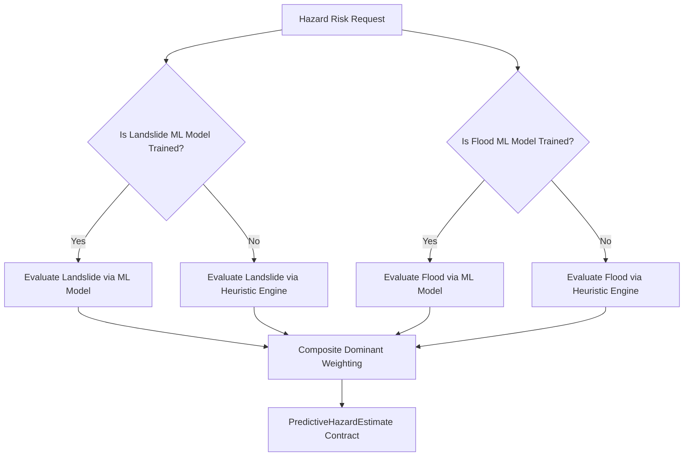

# MOSSAM Machine Learning Subsystem

This directory contains the modular, dataset-ready Machine Learning (ML) architecture for **MOSSAM** (Smart Logistics & Accessibility Intelligence Platform), tailored for independent flood, landslide, and compound hazard risk prediction across Assam and the Northeast India corridor.

> [!NOTE]
> **Current Platform State**: The backend architecture is fully prepared for future ML integration. However, **no real Assam datasets have been downloaded yet, and no ML models have been trained**. The platform currently operates using the transparent, physics-informed **heuristic risk engine as its reliable fallback**.

---

## Architecture Overview

```
backend/app/
├── ml/
│   ├── __init__.py               # ML package facade exports
│   ├── config.py                 # Configurable directories, column aliases, risk thresholds, hazard features
│   ├── dataset_loader.py         # CSV loader, path-traversal guard, geo/rainfall/slope/timestamp validation
│   ├── preprocessing.py          # Leakage-free preprocessing (imputation, scaling, encoding)
│   ├── feature_extractor.py      # Feature normalization from routes, weather, and API payloads
│   ├── model_manager.py          # Lifecycle manager for independent Landslide and Flood models
│   ├── predictor.py              # ML inference with honest fallback and genuine confidence (no hardcoded values)
│   ├── training.py               # Robust training pipeline with validation against imbalance & invalid categories
│   ├── evaluation.py             # Genuine classification and regression metric evaluations
│   ├── README.md                 # This documentation
│   ├── models/                   # Directory where trained .joblib artifacts and metadata JSON are stored
│   │   └── .gitkeep
│   ├── datasets/                 # Directory where future Assam CSV datasets should be placed
│   │   └── .gitkeep
│   └── schemas/
│       └── __init__.py           # Pydantic schemas for ML endpoints and services
├── services/
│   ├── risk_engine.py            # Physics-informed empirical heuristic risk engine
│   └── ml_prediction_service.py  # Hybrid coordinator for independent Landslide & Flood ML models + heuristic fallback
└── routes/
    └── ml_routes.py              # REST API endpoints (/api/ml/status, /datasets, /predict, /train)
```

---

## 1. Independent Flood and Landslide Models

Landslide susceptibility in the Northeast (steep slopes, antecedent saturation, soil geology) and Flood risk (river drainage density, lowlands, sudden rainfall intensity) are governed by distinct physical mechanics.

The architecture provides fully independent pipelines for each hazard:

| Component | Landslide Model | Flood Model |
|---|---|---|
| **Model Artifact** | `landslide_model.joblib` | `flood_model.joblib` |
| **Preprocessor Artifact** | `landslide_preprocessor.joblib` | `flood_preprocessor.joblib` |
| **Metadata File** | `landslide_metadata.json` | `flood_metadata.json` |
| **Core Features** | `slope_deg`, `rainfall_mm`, `antecedent_rain_mm`, `soil_moisture`, `elevation_m`, `terrain_type` | `rainfall_mm`, `antecedent_rain_mm`, `drainage_density`, `floodplain_exposure`, `elevation_m` |
| **Training Target** | `target_hazard="landslide"` | `target_hazard="flood"` |

---

## 2. Where to Place Assam Datasets

Place future CSV datasets in:
```
backend/app/ml/datasets/
```

- Any number of `.csv` files can be placed here (e.g., `assam_landslides_historical.csv`, `brahmaputra_flood_gauges.csv`, `imd_precipitation_daily.csv`).
- Dataset storage path can also be overridden via the environment variable:
  ```bash
  export MOSSAM_DATASET_DIR="/path/to/custom/datasets"
  ```
- **Path Traversal Protection**: Directory traversal attempts (e.g., `../../etc/passwd`) are strictly blocked by `DatasetLoader.get_dataset_path()`.

---

## 3. Dataset Validation Pipeline

`DatasetLoader` includes configurable domain validation without assuming coordinates exist in every dataset:

- **Geographical Coordinates**: If `lat` and `lng` columns exist, validates bounds (latitude [-90, 90], longitude [-180, 180]) and detects duplicate coordinate entries.
- **Rainfall Physical Bounds**: Flags negative rainfall and highlights extreme cloudburst outliers (> 2000 mm).
- **Slope Physical Bounds**: Checks that slope degrees lie strictly between 0° and 90°.
- **Timestamps & Date-Range**: Detects unparseable datetimes and computes `start_date` and `end_date` ranges.
- **Target Label Integrity**: Detects missing target labels, unique classes, and distribution stats.

---

## 4. Training Validation & Metadata

The training pipeline in `backend/app/ml/training.py` enforces:
1. **Record Count Threshold**: Rejects datasets with fewer than 10 records.
2. **Target Label Integrity**: Verifies target column presence and non-null values.
3. **Class Distribution**: Requires at least 2 distinct classes and flags invalid risk categories outside `['low', 'medium', 'high', 'critical']`.
4. **Feature Verification**: Verifies presence of required features for the requested hazard.
5. **Metadata Persistence**: Saves full lineage including:
   - `model_name`, `model_type`, `model_version`
   - `dataset_filename`, `dataset_source`
   - `training_timestamp`, `training_sample_count`, `testing_sample_count`
   - `features_used`, `evaluation_metrics`, `hyperparameters`

---

## 5. Confidence Calculation

Hardcoded confidence numbers (such as `0.85`) have been completely removed:
- **Classifiers**: Confidence is computed as the genuine maximum predicted class probability via `predict_proba`.
- **Regressors / Unsupported**: Returns `null` (`None`) when no genuine probability or uncertainty metric exists.

---

## 6. How to Train a Future Model

When Assam datasets are added to `backend/app/ml/datasets/`:

### Train Landslide Model:
```http
POST /api/ml/train
Content-Type: application/json

{
  "target_hazard": "landslide",
  "model_type": "random_forest",
  "dataset_filename": "assam_landslides.csv",
  "dataset_source": "ISRO Bhuvan",
  "test_size": 0.2
}
```

### Train Flood Model:
```http
POST /api/ml/train
Content-Type: application/json

{
  "target_hazard": "flood",
  "model_type": "random_forest",
  "dataset_filename": "brahmaputra_floods.csv",
  "dataset_source": "ASDMA CWC",
  "test_size": 0.2
}
```

---

## 7. How Prediction Connects to the Existing Risk Engine

`MLPredictionService` integrates independent models with the heuristic fallback:



Responses maintain full backward compatibility with the frontend schema while reporting `prediction_source` (`"machine_learning"` vs `"heuristic"`).
